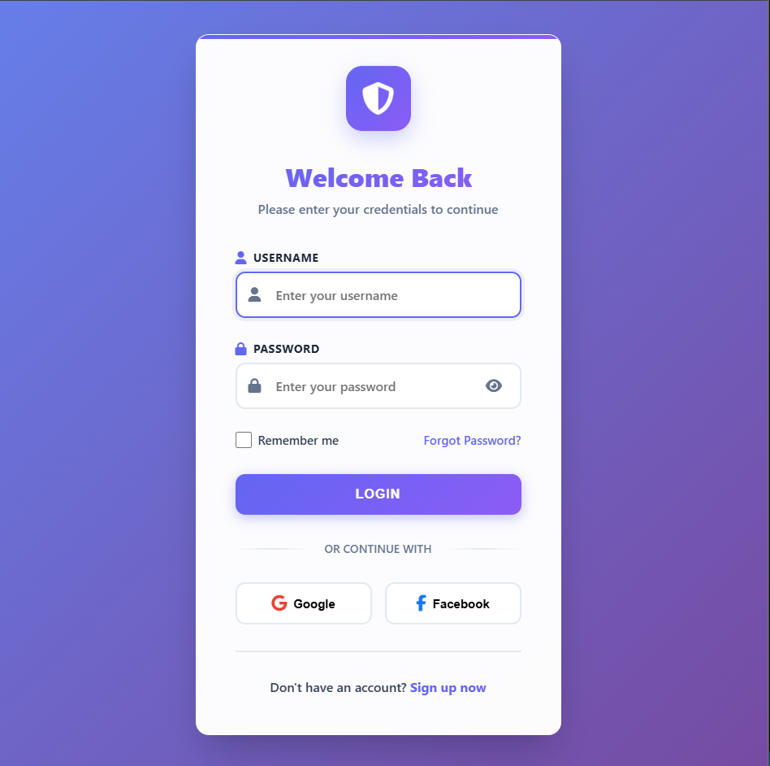

# 🧑‍💻 User Management System (PHP + MySQL + AJAX)

A simple **web-based system** built with PHP, MySQL, HTML, CSS, and JavaScript (AJAX) that allows secure login, user management (add, edit, delete), and full activity logging — all without reloading the page.

---

##  Features

### 🔐 Login Page

* Secure login using username and password.
* Passwords are **hashed** in the database.
* Login verification is done via **AJAX** (no page reload).
* Displays specific error messages for:

  * User not found
  * Incorrect password
  * Database error

###  Users Page

* Shows all registered users in a responsive table.
* Supports **Add**, **Edit**, and **Delete** operations.
* All actions are handled with AJAX — the page never reloads.
* Every operation (add, edit, delete) is recorded in logs.

### 🧾 Logs Page

* Displays all actions performed by users:

  * Login
  * Add user
  * Edit user
  * Delete user
* Shows which user performed the action and when.

---

##  Folder Structure

```
USER-MANAGEMENT-SYSTEM/
│
├── backend/
│   ├── add_user.php
│   ├── delete_user.php
│   ├── edit_user.php
│   ├── get_logs.php
│   ├── get_users.php
│   └── login.php
│
├── frontend/
│   ├── index.html
│   ├── Users.html
│   ├── Logs.html
│   ├── script.js
│   ├── Users.js
│   ├── Logs.js
│   ├── style.css
│   └── Users.css
│
├── Recording 2025-11-02 142817.mp4
└── database.sql
```

---

##  How to Run Locally

### Requirements:

* [XAMPP](https://www.apachefriends.org/)
* PHP 8+
* MySQL

##  Tech Stack

| Layer        | Technologies Used            |
| ------------ | ---------------------------- |
| Frontend     | HTML, CSS, JavaScript (AJAX) |
| Backend      | PHP (Procedural)             |
| Database     | MySQL                        |
| Local Server | XAMPP                        |

---

## 🧰 Database Information

### Tables:

1. **users** — Stores all user data (name, age, email, password hash).
2. **logs** — Stores every operation (login, add, edit, delete) with timestamp and username.


---

##  Screenshots

### 🔐 Login Page

*()*

### 👥 Users Page

*(Add your screenshot here)*

### 🧾 Logs Page

*(Add your screenshot here)*

---

## 🎥 Demo Video

📽️ [C:\xampp\htdocs\User-Management-System\Recording 2025-11-02 142817.mp4](Recording%202025-11-02%20142817.mp4)

---

## 🧑‍💻 Developer

**Noof Mohammed**
GitHub: [@Nouf Aljedaani](https://github.com/EngllNouf)

---

## 📝 Notes


* Error handling covers:

  * Invalid requests
  * Database connection errors
  * Empty fields
* Demo users share the same password: `123456` (hashed in DB).
t.
